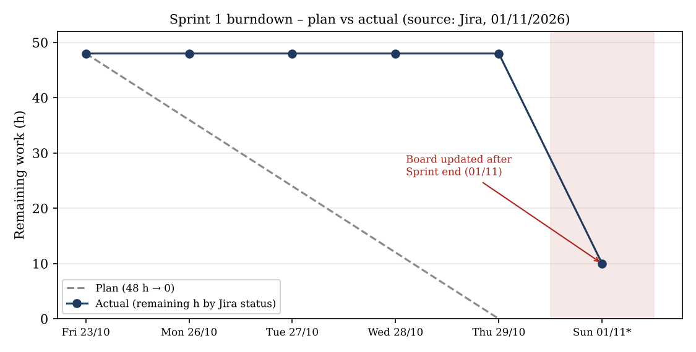
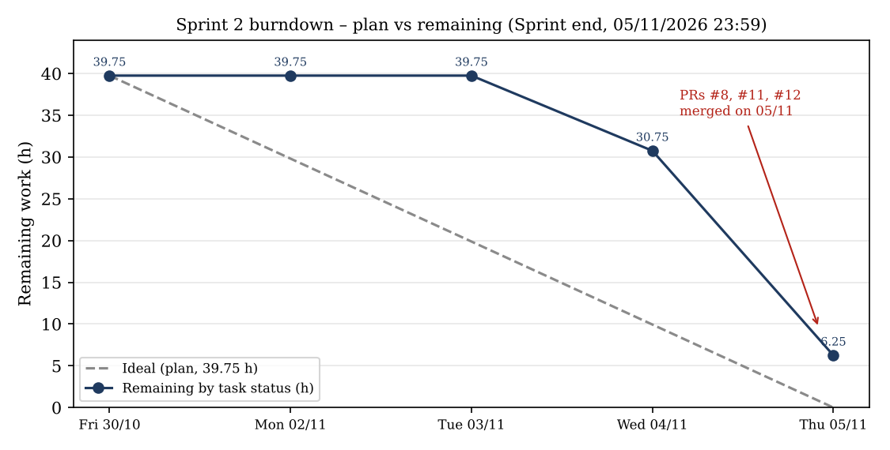
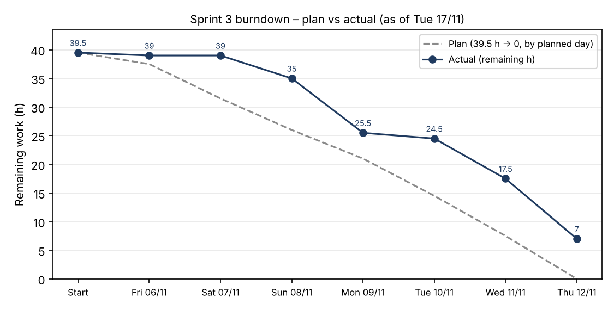

# Final Report – E-Commercial Book Store, Release 1.0

| Field | Value |
|---|---|
| Course | Software Project Management (72ITSE41503), Semester 261 – Final Project |
| Team | Team 6 "Page Turners" – Hồ Du Tuấn Đạt (Developer, Sprint Leader S1 and S3), Nguyễn Minh Chính (Product Owner, Developer, Sprint Leader S2) |
| Sponsor / Customer | Dr. Bùi Minh Phụng (as Ms. Le, owner of the bookstore chain) |
| Period | Fri 23/10/2026 – Fri 20/11/2026 (final presentation) · 3 one-week Sprints (N = 3) |
| Hosted site | https://pagetunnel.vercel.app/ (Vercel + Supabase) |
| Repository | https://github.com/Tdat10052499/E-Commercial-Book-Store |
| Jira board | https://tdat100524.atlassian.net/jira/software/projects/ECBS/boards/2 (project ECBS) |
| Data as of | Tue 17/11/2026 22:40 (GMT+7); NFR-03 check 17/11 22:33. Hours: Jira worklogs read 17/11 23:40 (**98.23 h**, all members' hours logged) |

## Version history
| Version | Date | Author | Change |
|---|---|---|---|
| 0.1 | 15/11/2026 | Nguyễn Minh Chính (PO) | First full draft from the Sprint records, the PO acceptance record, the UAT of 13/11, the CCB decision on CR-07 and Jira (read 15/11). Fields marked **TBD** need data from the team before submission |
| 0.2 | 16/11/2026 | Nguyễn Minh Chính (PO) | Final batch completed: PMP Final (c1), slides (c6) and Eval360 forms built from the same figures; no figure changed |
| 0.3 | 16/11/2026 | Nguyễn Minh Chính (PO) | Đạt's last S3 hours logged in Jira 16/11 (S3-T17 1 h, T19 1.5 h, T21 1.5 h, Daily D7 0.5 h): AC 85.23 → **89.73 h**, CPI 1.50 → **1.43**, EAC 18,489,818 VND. Tag `v1.0` and `baseline-v1.2` created 16/11 22:59 (release PR #64) |
| 0.4 | 17/11/2026 | Nguyễn Minh Chính (PO) | NFR-03/AC-03 checked on 17/11 22:33 (TC-F1-24 Pass) and NFR-03 accepted by the PO → **68 of 68 SP**, EV = BAC, **SPI 1.00, CPI 1.47**. Final submission moved to 18/11 23:59, presentation to Fri 20/11 |
| 0.5 | 17/11/2026 | Nguyễn Minh Chính (PO) | Chính's last hours logged in Jira 17/11: S3-T22 1 h, Daily D7 0.5 h, and four closure tasks S3-C1…C4 (Review 3 video 1 h, UAT 2 h, Final batch 15/11 2 h, 16–17/11 2 h) → AC **98.23 h**, **CPI 1.34**, EAC 19,646,000 VND |

**How to read the figures.** *Plan* = baseline values (Release Plan, Sprint Backlogs). *Actual* = Jira worklogs, GitHub and the PO acceptance record. Rate 200,000 VND per person-hour, N = 3 [03 §6.4]. Story points (SP) count only when the item meets the Story DoD (all ACs pass on the hosted site, reviewed PR, tests pass, PO acceptance).

## 1. Project summary and result of Release 1.0
**Goal.** Deliver a hosted, responsive Book Catalogue in which administrators manage accounts, roles and books, and customers browse, view, search and filter at least 30 sample books, accepted by the Sponsor through UAT on 13/11/2026.

**Result.**
- **Accepted by the Sponsor at UAT on 13/11/2026: 73 of 73 acceptance criteria Pass**, no defect found, no new change request (c5 UAT minutes).
- Scope delivered: F1–F5 and the approved change CR-06 (Store Staff role and "Last updated by" audit) – 20 backlog items. Nothing was cut; cart, checkout and social login stayed out of scope [03 §2.2].
- **68 of 68 SP meet the DoD** (baseline v1.2 after CR-07). The last item, NFR-03 (site online until 17/11), was checked on 17/11 and accepted by the PO.
- EVM at closure: **SPI 1.00, CPI 1.34** (§3.3).
- Quality: 114/114 automated tests; 6 defects found in the Sprints, all fixed (none Critical or High was recorded); 0 open defects.
- Two change requests handled through the Change Log and the CCB: CR-06 (Sponsor, Approve Option B) and CR-07 (PO, re-baseline of the S3 story points, Approve).

| Item | Plan (baseline) | Actual |
|---|---|---|
| Scope | 20 items, PSP 55 (v1.0) → 62 (v1.1, CR-06) → **68** (v1.2, CR-07) | 20/20 items delivered; 68/68 SP Done; 73/73 ACs Pass in UAT |
| Schedule | 3 Sprints, UAT 13/11, final 15/11 | UAT held 13/11 and accepted; acceptance came late in each Sprint (§2, §3.2) |
| Cost | BAC 26,400,000 VND (132 h) | AC 19,646,000 VND (98.23 h logged, incl. 7 h of closure work) – see §3.3 for the limits of this figure |
| Quality | 0 open Critical/High defects, 100 % AC coverage | 0 open defects; one or more test cases per AC (73 ACs) |

## 2. Results of each Sprint
| | Sprint 1 – Plan baseline & F1 | Sprint 2 – Execution, monitoring & change | Sprint 3 – Complete & acceptance |
|---|---|---|---|
| Dates · Leader | 23/10 – 29/10 · Hồ Du Tuấn Đạt | 30/10 – 05/11 · Nguyễn Minh Chính (PO) | 06/11 – 12/11 · Hồ Du Tuấn Đạt |
| Sprint Goal | Users register, log in and out; admin creates and locks accounts; non-admins blocked on the server | Admins manage books, categories and authors (soft delete); customers browse 12 books per page, newest first, on any device; + US-24 Store Staff (CR-06) | Customers open book details and search / filter by title, author, category and price range with pagination; Release v1.0 passes UAT |
| Goal met? | **Partly** – F1 built and deployed, but no item accepted by the Sprint end | **Partly** – all 9 items built and deployed, 2 accepted by the Sprint end | **Met** – 5 new items and 7 carried items accepted; UAT accepted 13/11 |
| Committed SP | 18 | 29 (24 + US-24 5) | 15 (v1.1) → **21** (v1.2) + 24 SP carried from S2 |
| SP Done at the Sprint end (velocity) | **0** | **5** (US-10, NFR-02) | **45** (21 new + 24 carried) |
| SP accepted later | 16 in S2 week (US-01…04 05/11, NFR-01 06/11); NFR-03 2 SP on 17/11 | 24 in S3 (09/11 – 12/11) | – |
| Task hours plan / actual | 48 / **41** | 39.75 / **24** | 39.5 / **26.23** (20.23 by 12/11 18:46 + 6 h logged 16–17/11); + 7 h closure work 13–17/11 (not planned) |
| Burndown (§3.2) | Flat at 48 h: hours reconstructed after the Sprint | 39.75 → 30.75 → **6.25 h**: most work merged on the last day | Flat D1–D2 and D5, steep D4 and D6, not 0 on D7 (Daily D2, D3 not held) |
| Main problems | S1 files not in the repo by 29/10 23:59 (I-01); no Planning Poker votes (I-04); hours reconstructed | F2 started late (I-02); hosted admin run left to the last hour; PRs merged without review (I-06); Daily not held (I-05) | Retro 2 / Planning 3 held 5 days late; Đạt busy 10/11 (I-07); UI work outside the backlog caused DEF-S3-03; Planning Poker after the build (CR-07) |
| How they were solved | Catch-up 29–30/10; Retro 1 actions A1–A3 (Daily, early drafts, same-day hours) | PO took the data-model task (I-02); S2 sized by hours not SP; carried items accepted in S3 after hosted runs | Daily plan with one Daily task per day; runner ≠ writer; approval before merge (A2); tasks updated the same day (A4) |

Velocity: S1 0 → S2 5 → S3 45 SP. Average = 68 / 3 = **22.7 SP per Sprint** against an expected 18.3 (v1.0) to 22.7 SP (v1.2). The S1 and S2 values are low because items were accepted one Sprint late, not because work was missing.

## 3. Plan versus actual
### 3.1 Scope
| | Baseline v1.0 (30/10) | Baseline v1.1 (04/11, CR-06) | Baseline v1.2 (15/11, CR-07) | Actual (15/11) |
|---|---|---|---|---|
| Items | 18 (F1–F5 + NFR) | 20 (+ US-24, US-25) | 20 | 20 delivered |
| PSP | 55 | 62 | 68 | 68 Done (NFR-03 on 17/11) |
| S1 / S2 / S3 SP | 18 / 24 / 13 | 18 / 29 / 15 | 18 / 29 / 21 | 0 / 5 / 45 Done per Sprint (+16 S1 SP accepted in the S2 week) |
| Added by CR | – | CR-06: +7 SP, +12 h, +2,400,000 VND | CR-07: +6 SP, 0 h, 0 VND (re-estimate only) | Both CRs delivered |
| Out of scope | Cart, checkout, payment, social login | same | same | Not built. Home-page UI polish (banners, book rails, Favorite button) was built **outside the backlog** – recorded as a lesson (LL-04) and as a known issue |

Product Backlog v1.4 and the Release Plan (PMP Part 3, §3.4 and §3.8) keep all three baselines.

### 3.2 Schedule
| Milestone | Plan | Actual |
|---|---|---|
| M2 Sprint 1 submission | 29/10 23:59 | S1 files completed in the repo on 30/10 (I-01); eLearning upload time not recorded |
| M3 Review 1 + CCB CR-06 | 30/10 | Held 30/10: CR-06 Approve, Option B |
| M4 Baseline v1.0 tag | 30/10 | `baseline-v1.0` created 02/11 |
| M5 Sprint 2 submission | 05/11 23:59 | Submitted; Sprint files committed 06/11 09:24 (upload time: TBD) |
| M6 Review 2 | 06/11 | Held 06/11 in class (Đạt presented); Retro 2 held 11/11 (5 days late) |
| M7 Release v1.0 + release notes | 12/11 | Release notes 1.0 on 12/11; release PR #57 merged into `main` 12/11; final release PR #64 merged 16/11 and tag `v1.0` created 16/11 22:59 (4 days late) |
| M8 Sprint 3 submission | 12/11 23:59 | Submitted on time (c2, c3, c5, c0) |
| M9 Review 3 + UAT | 13/11 | Review 3 video recorded and submitted; UAT 13/11 **Accepted** (73/73); CCB CR-07 Approve |
| M10 Final submission | 15/11 23:59 (moved to 18/11 23:59) | This report, c1 Final, c2 Final, slides, Eval360 |
| M11 Final presentation | 17/11 07:00 (moved to Fri 20/11) | Planned; NFR-03 checked on 17/11 22:33 – site online |

**Burndown charts (task hours remaining, plan vs actual).**

Sprint 1: the line stays flat because the hours were entered in Jira only after the Sprint (reconstructed 02/11 and 05/11). The plan line therefore cannot be compared day by day; this is the first data-quality lesson (LL-02).

Sprint 2: 39.75 → 30.75 h on day 4 and → 6.25 h on day 5 (05/11). Most work was merged on the last day (12:55 and 22:52), so the line drops steeply at the end. The lecturer commented on this at Review 2; Retro 2 action A4 answered it.

Sprint 3: flat on D1–D2 (S3-T01 not done, Daily D2 and D3 not held) and on D5 (Đạt busy, I-07); steep on D4 (−9.5 h) and D6 (−7.5 h). The D7 tasks were done on D7, so the line does not fall all at once as in S2. It does not reach 0, because Daily D2 and D3 were not held and are kept as deviations.

### 3.3 Cost – AgileEVM
Formulas [03 §6.4]: PV = BAC × n/N; EV = BAC × SP Done / PSP; AC = actual hours × 200,000; SPI = EV/PV; CPI = EV/AC; EAC = BAC/CPI; ETC = EAC − AC.

| Snapshot (baseline: BAC · PSP) | PV | EV (SP Done / PSP) | AC (hours) | SPI | CPI | EAC |
|---|---|---|---|---|---|---|
| End S1, 02/11 (v1.0: 24.0 M · 55) | 8,000,000 | 0 (0/55) | 3,900,000 (19.5 h) | 0.00 | 0.00 | – |
| End S2, 06/11 (v1.1: 26.4 M · 62) | 17,600,000 | 8,941,935 (21/62) | 13,000,000 (65 h) | 0.51 | 0.69 | 38,380,952 |
| End S3, 12/11 18:55 (v1.1: 26.4 M · 62) | 26,400,000 | 25,548,387 (60/62) | 17,046,000 (85.23 h) | 0.97 | 1.50 | 17,614,200 |
| Before the NFR-03 check, 16/11 (v1.2: 26.4 M · 68) | 26,400,000 | 25,623,529 (66/68) | 17,946,000 (89.73 h) | 0.97 | 1.43 | 18,489,818 |
| **Closure, 17/11 (v1.2: 26.4 M · 68)** | **26,400,000** | **26,400,000 (68/68)** | **19,646,000 (98.23 h)** | **1.00** | **1.34** | **19,646,000** |

Closure values: SV = EV − PV = 0 VND; CV = EV − AC = +6,754,000 VND; EAC = BAC / CPI = AC (the work is complete); ETC = 0 VND. The S1 actual hours were later corrected from 19.5 h to 41 h (part 2 of the hosted run logged 05/11), which is why AC at the end of S2 uses 65 h.

**Interpretation.**
- **Schedule:** SPI 1.00 at closure: all 68 SP are Done (NFR-03 checked on 17/11). During the project the SPI was far lower (0.00 after S1, 0.51 after S2), because items were accepted one Sprint after they were built. Earned value came late, not missing.
- **Cost:** CPI 1.34 means the team logged fewer hours (98.23 h, of which 7 h closure work) than budgeted (132 h). This is not only efficiency:
  - S1 and S2 hours were partly reconstructed after the Sprint (LL-02).
  - Part of the testing and documentation was AI-assisted (Appendix D), so the estimates made without AI were high (LL-06).
  - Some hours were logged days late (the last 13.5 h on 16–17/11, for work done 12–17/11).
  - Read the CPI as "the project used less logged effort than its budget", not as proof that the team works 50 % faster than planned.
- **CR-07 effect:** re-estimating the S3 items raised PSP from 62 to 68. EV changed by +75,142 VND at the end of S3 (60/62 → 66/68 of BAC); at closure EV = BAC either way.

### 3.4 Quality
| Metric (Quality Plan 4.2) | Target | Actual |
|---|---|---|
| Test-case coverage | 100 % of ACs | 73/73 ACs have at least one test case (F1 24, F2/F3/US-24 33, F4/F5/NFR-05/US-25 16) |
| AC pass rate at UAT | 100 % | **73/73 Pass (100 %)** on 13/11 |
| Hosted runs before UAT | runner ≠ writer from S3 | S3 cases written by Chính, run by Đạt: 15 Pass + TC-CR-08 Partial (no rename screen; the rename part is covered by `audit.test.js`) |
| Automated tests | all pass | 114/114 (`npm test`, 12/11) |
| Regression | each Sprint | F1 regression in S2 (16/16 automated); F1–F3 regression in S3: 71/71 automated + hosted smoke 15/15 |
| Defects by severity | 0 open Critical/High | 6 found, all fixed, 0 open: DEF-F1-01 (S1, severity not recorded), DEF-F2-01 Medium, DEF-F2-02 Low (S2), DEF-S3-01, -02, -03 Low (S3); 0 in UAT |
| Reopen rate | ≤ 10 % | 1 of 20 items (5 %): NFR-04 put on hold 12/11 by DEF-S3-03 and accepted again the same day |
| List page load (NFR-05) | median < 2 s | 0.50 s (`/books`), 0.38 s (page 3 with search and filter) |

## 4. Risks and changes
### 4.1 Risks that occurred and how well the responses worked
| Risk | What happened | Response | Effect of the response |
|---|---|---|---|
| R01 Workload of 2 members, R02 PMP from scratch | S1 files late in the repo (I-01) | Catch-up night, drafts reused from the Team Assignment, Retro 1 action A2 | Partly effective: S2 and S3 files submitted; S1 upload time not recorded |
| R05 CR-06 extra scope | +7 SP, +12 h in S2 and S3 (I-03) | Option B (phased: US-24 in S2, US-25 in S3), rebaseline v1.1 | Effective: CR-06 delivered in R1.0, 8/8 CR-06 ACs Pass in UAT |
| R06 Planning Poker evidence and commits | No voting rounds in S1/S2 (I-04); only 1 commit dated in the S1 week | Planning Poker Session 3 held 11/11 | Late: the votes came after the build and led to CR-07 (LL-03) |
| R12 Late integration of F2 | No F2 commit by 04/11 (I-02) | PO took the data-model task; S2 sized by hours | Delivered 05/11 22:52, but 24 SP had to be accepted in S3 (LL-01) |
| R09 Member busy | Đạt busy 10/11 (I-07) | T11 moved to D6, owner swap for test runs | Effective: US-13 accepted 12/11 |
| Process issues | PRs merged without review (I-06); Daily not held (I-05) | Approval before merge (A2), Daily on Discord 22:00 (A1) | Effective from 12/11 (all PRs approved); Daily D2, D3 still missed |

Risks that did not occur: R03 cold start (site online on 17/11), R04 Jira time tracking, R07 eLearning dates, R08 security defect, R10 F3/F4/F5 state, R11 Staff scope. Final status of every risk and issue: Workbook Final, sheets RiskRegister and IssueLog (risk register v1.8).

### 4.2 Change requests and their real impact
| CR | Request | CCB decision | Planned impact | Actual impact |
|---|---|---|---|---|
| CR-06 (Sponsor, 27/10) | Store Staff role; "Last updated by <name> at <time>" on every book | 30/10: **Approve – Option B** (US-24 in S2, US-25 in S3) | +7 SP (PSP 55 → 62), +12 h, +2,400,000 VND; rework US-03/US-04 | US-24 accepted 09/11, US-25 accepted 12/11; 8/8 CR-06 ACs Pass in UAT. Logged hours stayed inside the 40 h capacity per Sprint. 1 defect (DEF-S3-01, Low) |
| CR-07 (PO, 12/11) | Use the Planning Poker Session 3 votes as the S3 baseline (US-12 3 → 5, NFR-05 2 → 5, US-25 2 → 3) | 13/11: **Approve** – baseline v1.2. Reason: TBD | +6 SP (PSP 62 → 68), 0 h, 0 VND | Product Backlog v1.4, Release Plan §3.4/§3.8, EVM at closure on PSP 68; tag `baseline-v1.2` after merge |

## 5. Closure checklist
| # | Closure activity | Status | Evidence |
|---|---|---|---|
| 1 | Customer acceptance (UAT) | Done 13/11 – Accepted, 73/73 Pass | c5 UAT minutes; Sponsor signature: TBD |
| 2 | NFR-03 check (site online on 17/11) | Done 17/11 22:33 – site online, `/books` 30 titles, HTTP 200; NFR-03 accepted by the PO | TC-F1-24, `pm/sprints/S3/evidence/NFR-03-check-2026-11-17.md` |
| 3 | Release on `main` + tag `v1.0` + release notes | Done 16/11 – release PR #64 merged into `main`, tag `v1.0` on `main` (22:59); release notes 1.0 | GitHub |
| 4 | Hand-over of code | Repository with README (how to run, environment, seed); tests in `app/tests` | Repo |
| 5 | Hand-over of documents | c0–c6 on eLearning; Markdown sources in `pm/`, exports in `deliverables/` | Repo, eLearning |
| 6 | Archive | Baseline tags `baseline-v1.0`, `baseline-v1.1`, `baseline-v1.2` (16/11); Jira project ECBS kept; AI usage log kept | Repo, Jira |
| 7 | Close Sprint 3 in Jira and log the last hours | Partly – all hours logged by 17/11 (98.23 h; closure tasks S3-C1…C4); Sprint 3 still open in Jira on 17/11 (S3-T17, T19, T21, D7 not moved to Done) | Jira |
| 8 | Release resources | Hosting (Vercel, Supabase free tier) kept online at least until the final presentation (Fri 20/11), then left on the free tier; demo accounts kept until the lecturer has graded | Plan |
| 9 | Lecturer access to repo and board | TBD (confirm the lecturer can open both links) | – |
| 10 | Lessons learned and Eval360 | Lessons Learned §6; each member submits Eval360 | This report; eLearning |

## 6. Lessons Learned
### LL-01 Integrate and test on the host every day, not at the end
- **Situation:** In Sprint 2 most work was merged on the last day (05/11, 12:55 and 22:52), and the hosted admin run started in the last hour.
- **Impact:** Only 5 of 29 SP were Done at the Sprint end; SPI fell to 0.51; the burndown dropped steeply at the end and the lecturer criticised it; 24 SP had to be accepted in Sprint 3.
- **Cause:** The data model was late (I-02), so every dependent task waited; the hosted test was planned as one block at the end.
- **Lesson:** Work that is built is not value until it is tested and accepted; acceptance needs time inside the Sprint.
- **Recommendation:** Plan the hosted test and the PO acceptance as tasks on the day after each build; merge small PRs daily; put dependency tasks (data model) on D1.

### LL-02 Log hours on the same day
- **Situation:** S1 and S2 hours were entered after the Sprint, partly from memory (S1 19.5 h then corrected to 41 h; Đạt's S2 13.5 h logged 06/11).
- **Impact:** The S1 burndown is flat and useless for control; EVM AC changed after the reports were written; CPI is hard to trust.
- **Cause:** No routine for moving the card and logging time; the Daily was not held in S1 and S2.
- **Lesson:** EVM is only as good as the actual hours behind it.
- **Recommendation:** Move the card and log time when a task finishes (Retro 2 action A4); the Leader checks during the Daily that every Done task has hours.

### LL-03 Estimate with Planning Poker before the work starts
- **Situation:** S1 and S2 story points were set by the PO alone; the first real voting round (Session 3) took place on 11/11, after the S3 items were built.
- **Impact:** Votes were 21 SP instead of 15 SP; a change request (CR-07) and a rebaseline were needed in the last week; rubric evidence for estimation was weak.
- **Cause:** Time pressure in Sprint 1, and Planning 3 was held late.
- **Lesson:** Estimation is a planning activity; done after the build it only measures what already happened.
- **Recommendation:** Hold Planning Poker at Sprint Planning with a photo of every reveal; no item enters a Sprint without team votes (Definition of Ready).

### LL-04 Do not build outside the backlog
- **Situation:** Home-page UI polish (banners, book rails, a Favorite button, a new footer) was built and released in Sprint 3 without a backlog item.
- **Impact:** The new footer caused DEF-S3-03 (tap targets under 44 px), which put the accepted NFR-04 on hold on the last day; the Favorite button became a known issue in the release notes; the hours were not planned.
- **Cause:** Enthusiasm for the look of the product, and no rule that every change needs a backlog item.
- **Lesson:** Unplanned work is unmanaged risk, even when it looks small.
- **Recommendation:** Every change goes into the Product Backlog first (PO decides, through the Change Log if it changes scope); run the regression before releasing UI changes.

### LL-05 Make reviews and test ownership visible
- **Situation:** In S2 and early S3, PRs were merged without a recorded approval (I-06), and the same person wrote and ran the test cases.
- **Impact:** Weaker evidence for configuration management and quality; defects could hide behind the writer's assumptions.
- **Cause:** Small team, wish to move fast, no branch rule.
- **Lesson:** With two people, the review is the only independent check.
- **Recommendation:** Approve on GitHub before every merge (all PRs since 12/11 met this); a *Run by* column in every test file; the runner is never the writer (Retro 2 actions A2, A3).

### LL-06 Take AI assistance into account when estimating
- **Situation:** Part of the testing and documentation in S3 was AI-assisted; S3 logged 26.23 h against 39.5 h planned.
- **Impact:** CPI 1.34 at closure looks like strong efficiency but mixes several causes; the plan line of the burndown was too high.
- **Cause:** Estimates were made as if all work was manual.
- **Lesson:** A tool that changes productivity changes the baseline; the effect must be measured and declared.
- **Recommendation:** Record AI use per task (as the AI usage log does) and re-estimate with Planning Poker once the team knows how much it saves; keep the human review time in every estimate.

### LL-07 Hold the Scrum events on time
- **Situation:** Retro 2 and Planning 3 (planned 06/11) were held on 11/11; Daily D2 and D3 of Sprint 3 were not held.
- **Impact:** Retro 2 actions started only on D6; the S3 burndown stayed flat on D1–D2.
- **Cause:** No fixed channel and time until 11/11 (I-05).
- **Lesson:** A fixed time and place is what makes events happen.
- **Recommendation:** Fix the Daily slot (Discord 22:00) and the Review/Retro/Planning slot at the start of the project, and record each event on its day.

## Appendix A – Files submitted
| Batch | Files (prefix `HK261_SPM_FP_Team6_`) |
|---|---|
| Sprint 1 | c1_ProjectPlan.docx, c2_SprintBacklog_S1.xlsx, c3_SprintReport_S1.docx, c0_Eval_S1.xlsx |
| Sprint 2 | c2_SprintBacklog_S2.xlsx, c3_SprintReport_S2.docx, c4_ChangeRequest_CR01.docx, c0_Eval_S2.xlsx |
| Sprint 3 | c2_SprintBacklog_S3.xlsx, c3_SprintReport_S3.docx, c5_UAT.docx, c0_Eval_S3.xlsx |
| Final | c1_ProjectPlan_Final.docx, c2_SprintBacklog_Final.xlsx, c6_FinalReport.docx (this report), c6_Slides.pptx, Eval360_Team6_<StudentID>.xlsx (one per member) |

## Appendix B – Hosting, demo accounts and links
| Item | Value |
|---|---|
| Hosted URL | https://pagetunnel.vercel.app/ |
| Admin demo account | TBD – username and password entered in the submitted file only (never in the public repository) |
| Store Staff demo account | TBD – as above |
| Customer demo account | TBD – as above (or register a new account on the site) |
| Repository | https://github.com/Tdat10052499/E-Commercial-Book-Store (tag `v1.0`) |
| Jira board | https://tdat100524.atlassian.net/jira/software/projects/ECBS/boards/2 |
| Demo video (≤ 3 min, AC pass and fail) | TBD |
| Sprint Review 3 video | TBD (link) |

## Appendix C – Work allocation and hours (actual, Jira worklogs)
| Member | Role | S1 h | S2 h | S3 h | Closure 13–17/11 h | Total h | Pull requests opened |
|---|---|---|---|---|---|---|---|
| Hồ Du Tuấn Đạt | Developer, Leader S1 and S3 | 13.5 | 13.5 | 13.40 | – | 40.40 | 42 |
| Nguyễn Minh Chính | Product Owner, Developer, Leader S2 | 27.5 | 10.5 | 12.83 | 7.00 | 57.83 | 24 |
| **Team** | | **41** | **24** | **26.23** | **7.00** | **98.23** | **66** |

S1 hours by task owner (the S1 hours were reconstructed and entered by Chính). S3 includes the hours logged on 16–17/11: Đạt 4.5 h (S3-T17, T19, T21, Daily D7), Chính 1.5 h (S3-T22, Daily D7). Closure = Jira tasks S3-C1…C4 (Review 3 video, UAT 13/11, Final batch 15–17/11), logged 17/11. Commits: only 1 commit is dated in the S1 week (the S1 work was committed on 30/10); both members committed in S2 and S3. Commits made in AI-assisted sessions are part of the members' own pull requests.

## Appendix D – Declaration of AI use
The team used AI assistants as support only. Every use is recorded, one row per use, in `pm/ai-usage-log.md` (date, member, tool, purpose, files affected, who checked it). The member who used the tool reviewed the result, and the other member reviewed it again in the pull request. No actual data was produced by AI: hours, Planning Poker votes, CCB decisions, UAT results, acceptance decisions and evaluation scores come only from the team and the Sponsor.

| Member | Tools | Entries in the log (to 15/11) | Main uses |
|---|---|---|---|
| Hồ Du Tuấn Đạt | Claude (claude.ai, Claude Code), Atlassian MCP for reading Jira, Google Gemini (images) | 42 | Repository structure and roadmap; drafts of the PMP, Product Backlog, Sprint and status reports; F1–F5 code and automated tests; formatting of the submitted files; part of the hosted test runs with the member watching |
| Nguyễn Minh Chính | Claude (Claude app, cloud session, built-in browser) | 27 + this report | PO decisions written into the documents; drafts of the Sprint Backlogs, UAT script and minutes, CR-07, the Final Report; export scripts for the lecturer's templates; part of the hosted test runs with the member signed in (passwords typed by the member) |

The full log is attached to the Workbook Final and kept in the repository.
